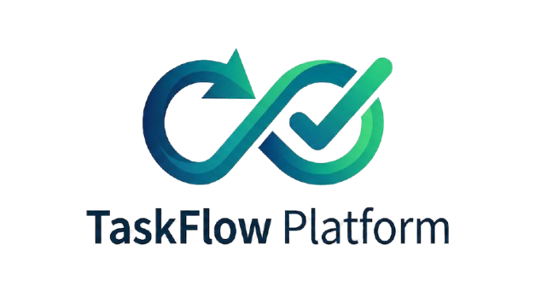

# TaskFlow Platform

<div align="center">



**Modern Event-Driven Workflow Automation Platform**

*A professional showcase demonstrating full-stack development skills with enterprise-grade security*

[](https://github.com/pepperonas/taskflow-platform/actions/workflows/tests.yml)
[](https://openjdk.org/)
[](https://spring.io/projects/spring-boot)
[](https://reactjs.org/)
[](https://www.typescriptlang.org/)
[](https://kafka.apache.org/)
[](LICENSE)

### 🌐 [Live Demo](https://taskflow.celox.io)

**Try it now**: [https://taskflow.celox.io](https://taskflow.celox.io)
**Login**: `admin` / `admin123` or `demo` / `demo123`

</div>

## 🎯 Was demonstriert dieses Projekt?

Dieses Projekt zeigt professionelle Software-Entwicklung mit modernen Technologien und Best Practices:

| Bereich | Skills |
|---------|--------|
| **Backend** | Event-Driven Architecture, Clean Code, Security by Design |
| **Frontend** | React 18, TypeScript, State Management, Error Handling |
| **DevOps** | Docker, CI/CD, Nginx, Health Checks |
| **Security** | JWT, Rate Limiting, SQL Injection Protection, Input Validation |
| **Testing** | Unit Tests, Integration Tests, E2E Tests |

📖 **Detaillierte Skills-Dokumentation**: [docs/SHOWCASE.md](docs/SHOWCASE.md)

## 🚀 Features

- ✅ **Event-Driven Architecture** with Apache Kafka
- 🔄 **Real-time Updates** via WebSocket
- 🔐 **JWT Authentication** with Spring Security
- 🛡️ **Multi-Layer Security** (Rate Limiting, Input Validation, SQL Protection)
- 📊 **RESTful API** with OpenAPI documentation
- 🎨 **Modern UI** with Material-UI
- 🐳 **Containerized** with Docker & Docker Compose
- 🧪 **Comprehensive Tests** (Unit, Integration, E2E)
- 🚀 **CI/CD Pipeline** with GitHub Actions
- 📧 **Email Integration** with SMTP support
- 🗄️ **Database Integration** with secure query execution
- 💻 **JavaScript Code Execution** with GraalVM sandboxing
- 📊 **Interactive Dashboard** with charts and analytics
- 🎨 **Showcase Page** with project overview and technologies
- 🏥 **Health Check Endpoints** for monitoring
- ⚠️ **Error Boundaries** for graceful error handling

## 📋 Tech Stack

### Backend
- **Java 17** with **Spring Boot 3.2.1**
- **Apache Kafka** for Event Streaming
- **PostgreSQL 15** as Database
- **Spring Data JPA** for Data Access
- **Spring Security** with JWT
- **Liquibase** for Database Migrations
- **OpenAPI 3.0** for API Documentation

### Frontend
- **React 18** with **TypeScript**
- **Redux Toolkit** for State Management
- **Material-UI (MUI)** as UI Framework
- **React Flow** for Workflow Visualization
- **Recharts** for Data Visualization
- **Axios** for HTTP Client
- **React Hook Form** for Form Handling
- **React Router** for Navigation

### DevOps & Infrastructure
- **Docker** & **Docker Compose**
- **GitHub Actions** for CI/CD
- **Nginx** as Reverse Proxy
- **Maven** for Build Management

## 🏗️ Architecture

```
┌─────────────┐      ┌──────────────┐      ┌─────────────────┐
│   Frontend  │─────▶│ Task Service │─────▶│   PostgreSQL    │
│  (React)    │      │ (Spring Boot)│      │                 │
└─────────────┘      └──────┬───────┘      └─────────────────┘
                            │
                            ▼
                     ┌─────────────┐
                     │Apache Kafka │
                     └──────┬──────┘
                            │
                            ▼
                ┌───────────────────────┐
                │ Notification Service  │
                │   (Kafka Consumer)    │
                └───────────────────────┘
```

## 🛠️ Prerequisites

- Java 17+
- Node.js 18+
- Docker & Docker Compose
- Maven 3.9+

## 🏃 Quick Start

### 1. Clone the Repository

```bash
git clone https://github.com/pepperonas/taskflow-platform.git
cd taskflow-platform
```

### 2. Start with Docker Compose

```bash
cd infrastructure/docker
docker compose up -d
```

### 3. Access the Application

**Production (Live Demo)**:
- **Frontend**: https://taskflow.celox.io
- **Dashboard**: https://taskflow.celox.io/dashboard
- **Showcase**: https://taskflow.celox.io/showcase
- **Backend API**: https://taskflow.celox.io/api
- **Swagger UI**: https://taskflow.celox.io/swagger-ui.html

**Local Development**:
- **Frontend**: http://localhost:8091
- **Backend API**: http://localhost:8082/api
- **Swagger UI**: http://localhost:8082/swagger-ui.html

### Default Credentials

- **Admin**: `admin` / `admin123`
- **Demo User**: `demo` / `demo123`

## 🧪 Testing

Das Projekt enthält eine umfassende Test-Suite mit automatisierter CI/CD-Pipeline.

### Continuous Integration

[](https://github.com/pepperonas/taskflow-platform/actions/workflows/tests.yml)

Die GitHub Actions Pipeline führt bei jedem Push automatisch aus:
- **Backend Tests** (JUnit 5, Mockito)
- **Frontend Tests** (Jest, React Testing Library)
- **E2E Tests** (Playwright)

### Backend Tests

```bash
cd backend
mvn test
```

**Enthält:**
- Unit Tests für Controller, Services und DTOs
- Integration Tests mit Testcontainers
- Security Tests (Rate Limiting, Input Validation)

### Frontend Tests

```bash
cd frontend
npm test
```

**Enthält:**
- Component Tests (React Testing Library)
- Redux Slice Tests
- Error Boundary Tests

### E2E Tests

```bash
cd frontend/e2e
npx playwright test
```

Voraussetzung: Backend auf :8080 (mit PostgreSQL und Kafka) und ein Frontend-Build, der mit `REACT_APP_API_URL=http://localhost:8080/api` gebaut und auf :3000 ausgeliefert wird (`npx serve -s build -l 3000`) – sonst zeigt der Build auf die Produktions-API.

**Testet:**
- Login/Logout Flow
- Task CRUD Operations
- Workflow Editor

### Integration Tests with Testcontainers

```bash
cd backend
mvn verify
```

## 📚 API Documentation

**Live Demo**: [https://taskflow.celox.io/swagger-ui.html](https://taskflow.celox.io/swagger-ui.html)

**Local Development**: http://localhost:8082/swagger-ui.html

### Main Endpoints

**Authentication**:
- `POST /api/v1/auth/register` - Register new user
- `POST /api/v1/auth/login` - Login

**Tasks**:
- `GET /api/v1/tasks` - Get all tasks
- `POST /api/v1/tasks` - Create task
- `PUT /api/v1/tasks/{id}` - Update task
- `DELETE /api/v1/tasks/{id}` - Delete task

**Workflows**:
- `GET /api/v1/workflows` - Get all workflows
- `POST /api/v1/workflows` - Create workflow
- `PUT /api/v1/workflows/{id}` - Update workflow
- `DELETE /api/v1/workflows/{id}` - Delete workflow

**Database Integration**:
- `POST /api/v1/database/query` - Execute SQL query (SELECT only, with security validation)

**Email Integration**:
- `POST /api/v1/email/send` - Send email via SMTP with HTML support and variable interpolation

**Code Execution**:
- `POST /api/v1/code/execute` - Execute JavaScript code in sandboxed GraalVM environment

**Credentials**:
- `GET /api/v1/credentials` - Get user credentials
- `POST /api/v1/credentials` - Create credential
- `DELETE /api/v1/credentials/{id}` - Delete credential

## 🌍 Production Deployment

The application is deployed and running at **[https://taskflow.celox.io](https://taskflow.celox.io)**

**Infrastructure**:
- ✅ HTTPS with Let's Encrypt SSL
- ✅ Nginx Reverse Proxy
- ✅ Docker Compose Orchestration (named project: `taskflow`)
- ✅ PostgreSQL 15 Database
- ✅ Apache Kafka Event Streaming
- ✅ Automated Certificate Renewal

## 🐳 Docker Deployment

### Build Docker Images

```bash
# Backend
cd backend/task-service
docker build -t taskflow/task-service:latest .

cd ../notification-service
docker build -t taskflow/notification-service:latest .

# Frontend
cd ../../frontend
docker build -t taskflow/frontend:latest .
```

### Run with Docker Compose

```bash
cd infrastructure/docker
docker compose up -d
```

## 📖 Documentation

- [**Showcase / Skills Overview**](docs/SHOWCASE.md) ⭐
- [Workflow Editor Guide](docs/WORKFLOW_EDITOR_GUIDE.md)
- [Workflow Editor Technical](docs/WORKFLOW_EDITOR_TECHNICAL.md)
- [Testing Guide](docs/TESTING.md)
- [Security Documentation](docs/SECURITY.md)
- [Database Integration Guide](docs/DATABASE_INTEGRATION.md)
- [Email Integration Guide](docs/EMAIL_INTEGRATION.md)
- [Code Execution Guide](docs/CODE_EXECUTION.md)

## 🔧 Development

### Backend Development

```bash
cd backend
mvn spring-boot:run -pl task-service
```

### Frontend Development

```bash
cd frontend
npm start
```

## 🌟 Key Features Explained

### Event-Driven Architecture

Tasks emit events (created, updated, completed, deleted) to Kafka topics. The Notification Service consumes these events and sends notifications.

### Kafka Topics

- `task.created` - New task events
- `task.updated` - Task update events
- `task.completed` - Task completion events
- `task.deleted` - Task deletion events

### Design Patterns

- **Repository Pattern** - Data Access Layer
- **Factory Pattern** - Event Creation
- **Strategy Pattern** - Notification Types
- **Observer Pattern** - Event Handling
- **Builder Pattern** - DTOs & Entities

## 🔒 Security

The TaskFlow Platform includes comprehensive security measures:

| Feature | Description |
|---------|-------------|
| **Rate Limiting** | 5-20 req/min per endpoint (Login, Code, DB, Email) |
| **JWT Authentication** | Secure token-based authentication with expiration |
| **Input Validation** | Bean Validation for all DTOs (@Valid, @NotBlank, @Email) |
| **SQL Injection Protection** | Keyword blocking, pattern detection, query type restrictions |
| **Code Sandboxing** | GraalVM with restricted permissions, timeout protection |
| **Security Logging** | All suspicious activity is logged and monitored |
| **Error Handling** | No stack traces in production, graceful degradation |

### Health Check

```bash
curl https://taskflow.celox.io/api/v1/health
```

For detailed security documentation, see [docs/SECURITY.md](docs/SECURITY.md).

## 🤝 Contributing

Contributions are welcome! Please feel free to submit a Pull Request.

## 📄 License

This project is licensed under the **MIT License** - see the [LICENSE](LICENSE) file for details.

Copyright © 2026 Martin Pfeffer

## 👤 Author

**Martin Pfeffer** © 2026

- Website: [celox.io](https://celox.io)
- GitHub: [@pepperonas](https://github.com/pepperonas)
- Repository: [https://github.com/pepperonas/taskflow-platform](https://github.com/pepperonas/taskflow-platform)

## 🙏 Acknowledgments

- Spring Boot Team
- Apache Kafka Community
- React Team
- Material-UI Team

---

<div align="center">
Made with ❤️ by Martin Pfeffer | © 2026 celox.io
</div>
